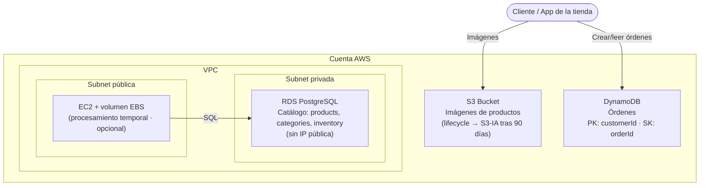

# Arquitectura — Backend para una Tienda Online

> Plantilla para que documentes **tu** diseño. Complétala a medida que construyes tu stack de CDK.
> El corazón de este reto es la **justificación**: no basta con crear los recursos, debes explicar
> **por qué** cada tipo de dato va en cada servicio.

---

## 1. Diagrama de arquitectura

_Este es un diagrama de referencia. Reemplázalo por el tuyo a medida que diseñas tu stack._

> ℹ️ La **EC2 con EBS** existe para cubrir el requisito de **almacenamiento en bloque / procesamiento
> temporal** (R4). No necesitas construir una API completa: basta con la instancia y su volumen EBS
> montado. El foco del reto es **elegir y aprovisionar el almacenamiento correcto**, no programar el backend.

---

## 2. Componentes y justificación (lo más importante)

| Dato | Servicio elegido | ¿Por qué este y no otro? | Decisiones de diseño |
|---|---|---|---|
| Imágenes de productos | **S3** | _¿Por qué objeto y no bloque/relacional?_ | _lifecycle, clase de almacenamiento, versioning_ |
| Catálogo (productos/categorías/inventario) | **RDS PostgreSQL** | _¿Por qué relacional? ¿Qué relaciones necesitas?_ | _tipo de instancia, subnet privada, multi-AZ_ |
| Órdenes de compra | **DynamoDB** | _¿Por qué NoSQL? ¿Patrón de acceso?_ | _PK/SK, billing mode, streams_ |
| Procesamiento temporal | **EBS** | _¿Por qué bloque y no S3?_ | _tamaño, tipo (gp3), removalPolicy_ |

> 💡 **Pista para la justificación:** piensa en estructura del dato (estructurado vs no estructurado),
> patrón de acceso (lectura vs escritura, por clave vs por consulta compleja), tamaño del objeto,
> necesidad de relaciones/joins, y costo por GB vs costo por petición.

---

## 3. Almacenamiento de objetos — S3

- ¿Qué **lifecycle policy** configuraste? (transición a `INFREQUENT_ACCESS` tras 90 días)
- ¿Activaste **versioning** o **bloqueo de acceso público**?
- ¿Cómo sirves las imágenes al cliente? (acceso directo, presigned URLs, CloudFront)

_Completa aquí tu razonamiento._

---

## 4. Base de datos relacional — RDS PostgreSQL

- ¿En qué **subnet** vive? ¿Cómo garantizas que **no tiene IP pública**?
- ¿Qué **Security Group** permite el acceso? ¿Desde dónde?
- ¿Dónde guardas la **contraseña**? (sugerencia: Secrets Manager)
- Esquema del catálogo: ver [`application/schema.sql`](../application/schema.sql).

_Completa aquí tu razonamiento._

---

## 5. Base de datos NoSQL — DynamoDB

- **Partition key:** `customerId` · **Sort key:** `orderId` — ¿por qué este modelo de claves?
- ¿Qué **patrones de acceso** soporta? (todas las órdenes de un cliente, una orden concreta)
- ¿Por qué `PAY_PER_REQUEST` en vez de capacidad aprovisionada?

_Completa aquí tu razonamiento._

---

## 6. Almacenamiento en bloque — EBS

- ¿Qué **tamaño** y **tipo** (gp3, io2) elegiste y por qué?
- ¿Qué **removalPolicy** aplicaste para evitar volúmenes huérfanos?
- ¿Para qué usa la EC2 este disco temporal?

_Completa aquí tu razonamiento._

---

## 7. Flujo de despliegue

- Lenguaje elegido para CDK: `______`
- Comando(s) para desplegar: `cdk deploy`
- Comando(s) para destruir: `cdk destroy`

---

## 8. Boss Fight (si lo abordaste)

- **DynamoDB Streams:** ¿cómo lo habilitaste? ¿qué eventos procesas?
- **RDS Read Replica:** ¿cómo distribuyes las lecturas? ¿la eliminaste antes del destroy?
- **S3 cross-region replication:** ¿a qué región replicas? ¿qué configuraste?
- ¿Cómo lograste estos cambios **sin recrear** los recursos existentes?

_Completa aquí tu solución._
